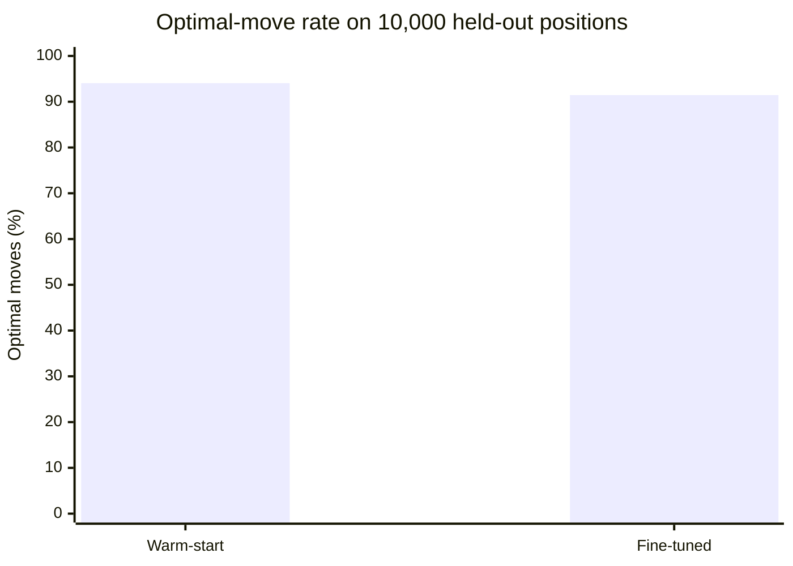

# Chess Endgame RL: Learning to Convert KRvK

## Project summary

This project studies whether neural-network agents can learn to convert a **King + Rook versus King (KRvK)** chess endgame into checkmate. The agent controls White's king and rook; a Black lone-king defender resists. The main results compare a reward-trained DQN baseline, a tablebase-supervised Dueling network, and reward-based Double-DQN fine-tuning of that supervised model.

KRvK is small enough to have an exact endgame tablebase. The tablebase supplies optimal-move labels and evaluation ground truth. It is used as a reference, not as evidence that a learned agent is stronger than an exact solver. This is an endgame research and teaching demonstration, not a general chess engine.

## Lab rubric

### 1. Problem definition and RL formulation 

**Problem.** Convert a winning KRvK position into checkmate while the opposing king tries to avoid it. This is a fully observable, turn-based sequential decision problem. Rewards are delayed until terminal outcomes, and many nominal moves are illegal.

**Why use reinforcement learning?** The problem provides a controlled setting for studying sequential decisions, delayed reward, and legal-action selection. Since an exact solver exists for this small endgame, it also provides ground truth for labels and evaluation. The project does not claim RL is needed to solve KRvK or that results transfer to full chess.

**Markov decision process (MDP).** A training transition consists of one attacker move and, unless the game has ended, one defender reply.

| Element | Definition |
|---|---|
| Environment | Three-piece KRvK. The attacker plays White; the defender is random or tablebase-optimal. |
| State | Model-specific. The reward-trained DQN uses 193 values: three 8×8 piece planes plus normalized move count. The Dueling models use 18 binary 8×8 planes in side-to-move perspective, encoding pieces and relevant board state. |
| Action | Model-specific. DQN uses 36 compact king/rook moves. Dueling models use `from_square × 64 + to_square` (4,096 indices). A legal-action mask prevents selecting illegal moves. The encoding supports queen promotion only. |
| Reward | The reward-trained DQN receives +10 for checkmate, with a speed bonus; −5 for stalemate; −8 if the rook is captured; −0.02 per step; +0.3 for check; and a small king-distance shaping term. Failure to mate within the move limit incurs −3. |
| Discount and horizon | Double-DQN fine-tuning uses γ = 0.99 by default. Its training transition is one attacker/defender turn, with a 100-ply episode horizon. Terminal outcomes and horizon truncation are distinguished. |
| Fine-tuning reward | The recorded Double-DQN setup uses +1 for attacker checkmate, −1 for attacker loss, 0 for a draw, and −0.001 per nonterminal step. Optional potential shaping is `γΦ(s′) − Φ(s)`; a supervised anchor loss regularizes updates toward tablebase labels. |
| Episode end | Checkmate, stalemate, insufficient material, claimable draw, or the 100-ply training horizon. Reaching the horizon is a truncation, not a checkmate. |

### 2. Implementation and working RL agent

#### Algorithms and implementation

| Agent | Algorithm and training | Purpose |
|---|---|---|
| DQN baseline | Deep Q-Network trained from scratch using game rewards. It uses the 193-value input and 36-action encoding. | Reward-only RL baseline. |
| Dueling warm-start | Convolutional Dueling network trained with supervised labels from the exact tablebase. It uses 18 × 8 × 8 inputs and 4,096 action indices with legal-action masking. | Solver-guided reference policy; this stage is supervised learning, not RL. |
| Warm-start + Double DQN | Starts from the supervised Dueling checkpoint and continues with reward-based Double-DQN updates. It uses the same representation and action encoding as the warm-start. | Tests whether reward-based fine-tuning improves the solver-supervised policy. |

The Dueling network has separate value and advantage heads. During action selection, only legal actions are considered. The environment checks chess legality and handles checkmate, draws, piece capture, and the move horizon. Automated tests cover environment rules, action encoding, tablebase behavior, training/evaluation components, and the UI API.

#### Training record and parameter selection

- The KRvK warm-start checkpoint was trained for **5 of the configured 10 supervised epochs** (seed 7) and retained from epoch 5. On its 17,517-position validation split it reached 94.19% optimal moves.
- The bounded Double-DQN run started from that checkpoint, used the optimal defender, and stopped after 1,000 environment steps (79 episodes) as validation move quality degraded. The retained checkpoint was the best observed RL snapshot.
- The DQN baseline is trained from scratch from reward feedback; its recorded game results are reported below.
- Hyperparameters are **implementation defaults, not empirically optimized settings**. For example, supervised learning rate is 3e-4, batch size 64, and configured epochs 10; Double-DQN defaults include γ = 0.99, learning rate 1e-4, replay capacity 50,000, and target-network synchronization every 1,000 updates.
- No systematic hyperparameter sweep or multi-seed selection was run. These values must not be described as experimentally optimal.

The trained checkpoints are included in the repository. To run the demo, training is not required.

#### Run the demo

From the repository root, install the dependencies and start the local server:

```powershell
python -m venv .venv
.\.venv\Scripts\Activate.ps1
python -m pip install -r requirements.txt
python -m pip install -e ".[train]"
python scripts\run_server.py --port 8000
```

Open <http://127.0.0.1:8000>. Keep the page and server on the same port. PyTorch is required to load the Dueling checkpoints.

### 3. Results and analysis

#### Evaluation protocol and metrics

The recorded KRvK evaluation uses **Protocol v1**, seed **7**, **150 games per agent per defender**, the same held-out attacker-winning starting positions, and a **100-ply horizon**. Defenders are random or tablebase-optimal. The separate move-quality evaluation uses **10,000 held-out positions** and measures how often each Dueling agent selects a tablebase-optimal move. The DQN's action representation is different, so it has no comparable move-quality figure in this report.

The following figures are percentages. Games not won by the attacker are reported as draws with their causes separated; the KRvK attacker cannot be checkmated, so there were no losses.

#### Checkmate win rate by defender

```mermaid
xychart-beta
    title "Checkmate wins in 150 games per defender"
    x-axis ["DQN", "Warm-start", "Fine-tuned"]
    y-axis "Win rate (%)" 0 --> 100
    bar [0, 96, 80.67]
    bar [0, 82.67, 56]
```



**Series order:** first bar is versus the random defender; second bar is versus the tablebase-optimal defender. The warm-start scored 144/150 wins against random defense and 124/150 against optimal defense. Fine-tuning scored 121/150 and 84/150 respectively. DQN scored 0/150 against either defender in this recorded protocol.

#### Tablebase move quality



| Agent | Optimal moves | Suboptimal moves | Winning position changed to a draw |
|---|---:|---:|---:|
| Tablebase warm-start | 94.06% | 5.94% | 0.52% |
| Warm-start + Double DQN | 91.45% | 8.55% | 0.48% |
| DQN baseline | Not measured comparably | — | — |

Move quality and game outcomes measure different things: the first is a position-level comparison with solver-optimal actions; the second measures full games against defenders. They should not be treated as interchangeable.

#### Game outcomes

Each row is 150 games. “Other draws” include drawn outcomes not classified as rook capture, repetition, or horizon draw.

| Agent | Defender | Checkmates | Rook captured | Repetition | Horizon draw | Other draws |
|---|---|---:|---:|---:|---:|---:|
| DQN | Random | 0 | 73 | 42 | 35 | 0 |
| DQN | Tablebase-optimal | 0 | 129 | 21 | 0 | 0 |
| Tablebase warm-start | Random | 144 | 5 | 0 | 0 | 1 |
| Tablebase warm-start | Tablebase-optimal | 124 | 19 | 5 | 0 | 2 |
| Warm-start + Double DQN | Random | 121 | 2 | 24 | 0 | 3 |
| Warm-start + Double DQN | Tablebase-optimal | 84 | 29 | 34 | 0 | 3 |

#### Interpretation and limitations

- The tablebase-supervised warm-start performed best in this recorded evaluation.
- Double-DQN fine-tuning did not improve the warm-start: optimal-move rate decreased from 94.06% to 91.45%, and wins against the optimal defender decreased from 124/150 to 84/150.
- The reward-trained DQN baseline did not checkmate within the recorded games. Many games ended through rook capture, repetition, or the horizon.
- These results cover **one seed and KRvK only**. They are not an Elo rating, a full-chess evaluation, a multi-seed statistical result, or evidence of transfer to larger endgames.
- Hyperparameters were not selected through a tuning sweep. Further seeds and controlled parameter experiments are needed before making broader claims.

The machine-readable recorded evaluation is [`results/results.json`](results/results.json); the implementation defaults and their status are documented in [`docs/HYPERPARAMETERS.md`](docs/HYPERPARAMETERS.md).
